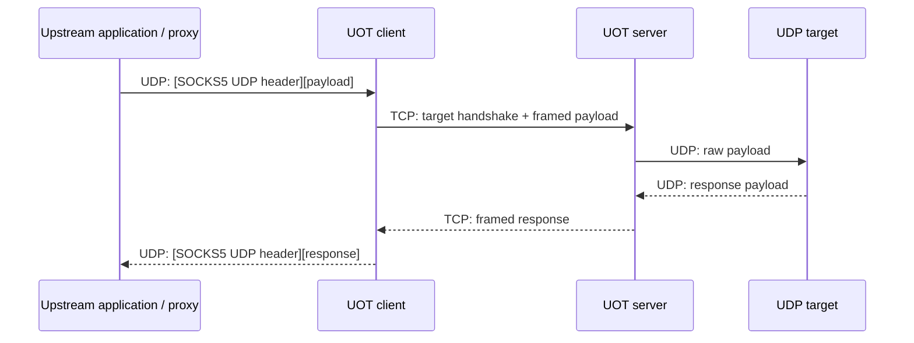

# UDP-Over-TCP

UDP-Over-TCP is a Go library that relays UDP payloads over a TCP connection. The client receives a UDP datagram containing its target address and sends it to the server over TCP. The server then forwards the payload to the target over UDP and returns the response through the same path.

Only UDP **payloads** are relayed; IP and UDP headers are not included. The default implementation uses the SOCKS5 address format, but it is not a complete SOCKS5 server and does not implement authentication, `UDP ASSOCIATE`, or other control-plane features.



## When to use it

This project is useful when:

- An existing application can send SOCKS5 UDP request datagrams and needs to carry that traffic across a TCP-only path.
- You want to reuse `Client` and `Server` while providing a custom transport through the `PacketConn` and `Conn` interfaces.

The default client does not accept arbitrary raw UDP datagrams because it needs to read the target address from each incoming packet. To forward all traffic to a fixed target, provide your own `PacketConn` implementation.

TCP packet loss blocks later data on the same connection (head-of-line blocking), so this approach does not preserve all of UDP's behavior on unreliable networks.

## Quick start

Go 1.20 or later is required.

Clone and build the command-line program:

```bash
git clone https://github.com/justlovediaodiao/udp-over-tcp.git
cd udp-over-tcp
go build -o uot ./cmd
```

Start the server on a machine that can reach the target UDP services:

```bash
./uot -l :8088 -v
```

Start the client near the application:

```bash
./uot -l :8080 -s 203.0.113.10:8088 -v
```

Replace `203.0.113.10` with the server's address. In this example:

- `:8080` accepts datagrams in SOCKS5 UDP request format.
- The client connects to `203.0.113.10:8088` and carries payloads over TCP.
- The server sends ordinary UDP datagrams to the target encoded in each new session.

Command-line options:

| Option | Description |
| --- | --- |
| `-l address` | Required. Local listen address: UDP in client mode, TCP in server mode |
| `-s address` | Run in client mode and connect to this server; omit it to run in server mode |
| `-v` | Log connections, relay errors, and dropped packets |

> Warning: the default protocol provides no authentication or encryption. Do not expose the server as an unrestricted UDP relay on an untrusted network. Add access control and a secure transport where necessary.

## Use as a Go library

Install the package:

```bash
go get github.com/justlovediaodiao/udp-over-tcp
```

### Client

This client accepts SOCKS5 UDP request datagrams on `:8080` and connects to the TCP server at `127.0.0.1:8088`:

```go
import (
    "net"

    uot "github.com/justlovediaodiao/udp-over-tcp"
)

func main() {
    // Example code; error handling is omitted.
    conn, err := net.ListenPacket("udp", ":8080")
    client := uot.Client{
        Dialer: func(addr string) (uot.Conn, error) {
            conn, err := net.Dial("tcp", addr)
            if err != nil {
                return nil, err
            }
            return uot.DefaultOutConn(conn), nil
        },
    }
    client.Serve(uot.DefaultPacketConn(conn), "127.0.0.1:8088")
}
```

`Client.Timeout` controls how long a mapping may receive no client packets before it is closed. The default is 5 minutes. `Client.BufSize` is the maximum number of UDP datagrams queued for writing to TCP per mapping. The default is 8; new datagrams are dropped when the queue is full.

### Server

This server listens on `:8088`. Each accepted TCP connection becomes one UDP relay session:

```go
import (
    "net"

    uot "github.com/justlovediaodiao/udp-over-tcp"
)

func main() {
    // Example code; error handling is omitted.
    l, err := net.Listen("tcp", ":8088")
    var server uot.Server
    for {
        conn, err := l.Accept()
        go server.Serve(uot.DefaultInConn(conn))
    }
}
```

## Default protocol

### Between the application and client: UDP

`DefaultPacketConn` uses the SOCKS5 UDP request format defined in RFC 1928, section 7:

```text
+-----+------+----------+----------+
| RSV | FRAG | DST.ADDR |   DATA   |
+-----+------+----------+----------+
|  2  |  1   | Variable | Variable |
+-----+------+----------+----------+
```

`DST.ADDR` is a SOCKS5 address containing an address type, an IPv4 address, IPv6 address, or domain name, and a port. `DATA` is the UDP payload. Fragment reassembly is not implemented, so callers should send complete datagrams with `FRAG = 0`.

### Between the client and server: TCP

After opening a TCP connection, the client sends the target address once and then sends length-prefixed payload frames:

```text
Request:  [SOCKS5 target][length: 2 bytes][payload][length: 2 bytes][payload]...
Response:                [length: 2 bytes][payload][length: 2 bytes][payload]...
```

The length is an unsigned two-byte big-endian value describing the following UDP payload. A TCP session has one target address, so response frames do not include an address.

## Connection model

The default client maps sessions by the UDP sender's IP address and port:

1. The first datagram from a sender opens a TCP connection to the server.
2. Its target address is sent during the handshake.
3. Later datagrams from the same sender reuse that connection and must use the same target until the mapping expires.
4. If no client packet arrives within `Client.Timeout`, the connection closes. The next datagram creates a new mapping.

If one UDP source port must communicate with multiple targets at the same time, provide a different `PacketConn` or client mapping strategy, or use a separate source port for each target.

## Custom protocols

- Implement `PacketConn` to change how the client reads target addresses from UDP datagrams and wraps response data.
- Implement `Conn` to change the TCP-side handshake and framing. It can also wrap TLS, authentication, or another stream transport.
- Use `DefaultPacketConn`, `DefaultOutConn`, and `DefaultInConn` to select the default protocol described above.

See [uot.go](./uot.go) for the interface definitions.
